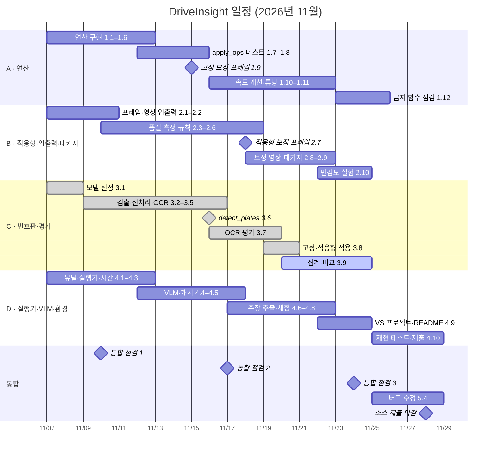

# DriveInsight 역할 분담 및 WBS

Digital Image Processing Team Project 02 · Team 16 Black Box · 초판 2026-11-06 · **최신화 2026-11-16**

[English](team_plan.md) · [기능 명세](feature_spec.ko.md) · [팀원 C 가이드](member_c_guide.ko.md)

상태 열은 11/16 기준 저장소에 올라온 내용만 반영합니다. **—** 는 저장소에 아직 없다는 뜻입니다(저장소 밖에서 진행 중일 수 있음).

## 개발 역할 4등분

코드를 네 모듈로 나누고 한 사람이 한 모듈을 끝까지 책임집니다. 기능별 입출력과 검증 기준은 [기능 명세](feature_spec.ko.md)에 있습니다.

| 팀원 | 담당 모듈 | 구현할 기능 | 다른 팀원에게 넘기는 것 |
| --- | --- | --- | --- |
| **A · 영상처리 연산** | `src/dip/` | 색 공간 변환, 히스토그램 평활화, 감마 보정, Gaussian·Median 필터, Unsharp masking(모두 NumPy 직접 구현), `apply_ops`, `fixed_enhance`, 고정 보정 프레임 일괄 생성, 단위 테스트, 전체 영상용 속도 개선, 금지 함수 점검 스크립트 | `apply_ops` → B, 고정 보정 프레임 → C·D |
| **B · 적응형 보정 + 영상 입출력 + 패키지** | `src/io/`, `src/adaptive/`, `src/package/` | 영상 입출력(`extract_frames`, `read_video`, `write_video`), 품질 측정, 규칙 기반 파라미터 선택, `adaptive_enhance`, 적응형 프레임 일괄 생성, 보정 영상 생성, 리뷰 패키지 출력, 임계값 민감도 실험 스크립트 | 원본 프레임·`video_io` → 전원, 적응형 보정 프레임 → C·D |
| **C · 번호판 인식 + 평가 집계** | `src/plate/`, `src/eval/` | 차량·번호판 후보 검출, 크롭 전처리 직접 구현, OCR 연결, readable/uncertain/unreadable 판정, `detect_plates`, OCR 평가, OCR·VLM·시간을 합친 전체 집계와 조건 간 비교표 | `detect_plates` → D, OCR 결과 → B(패키지), 비교표 → 전원 |
| **D · 실험 실행기 + VLM + 실행 환경** | `src/common/`, `src/pipeline/`, `src/vlm/` | 공용 유틸, `main.py`, `run_experiment`(프레임 목록 일치 검사, 설정 스냅샷), 시간 측정, VLM 연결·프롬프트·스키마, 응답 캐시, 주장 추출, VLM 채점, VS 프로젝트·README, 재현 테스트와 제출 | 실행기 → 전원, VLM 요약 → B(패키지), 채점 결과·`timing.csv` → C(집계) |

전원이 함께 하는 개발 작업은 세 번의 통합 점검과 마지막 주 버그 수정뿐입니다. 최종 발표자가 무작위로 뽑히므로 매주 한 번 각자 자기 모듈을 5분씩 설명합니다.

### 데이터 작업 4등분

세 작업을 클립 단위로 나눕니다. 클립은 조건별로 한 명씩 모으고, 라벨링은 자기가 모은 클립을, 사실 검증은 남이 모은 클립을 맡아 판단이 한쪽으로 치우치지 않게 합니다. 한 사람당 클립 2–3개, 평가 프레임 8–12장입니다.

| 팀원 | 클립 수집 (11/7–11/8) | 정답 라벨링 (11/9–11/14) | 라벨 교차 검수 (11/15–11/16) | VLM 사실 검증 (11/20–11/22) |
| --- | --- | --- | --- | --- |
| A | 저조도·야간 2–3개 | A의 클립 | B의 라벨 | B의 클립 |
| B | 비 2–3개 | B의 클립 | A의 라벨 | C의 클립 |
| C | 안개·눈 2–3개 | C의 클립 | D의 라벨 | D의 클립 |
| D | 역광·터널·혼합 조건 2–3개 | D의 클립 | C의 라벨 | A의 클립 |

- **클립 수집:** 클립당 10–30초, 공개 데이터셋이나 본인 촬영본만 씁니다. 출처·라이선스와 평가할 타임스탬프 3–5개를 적어 11/8 오전까지 올리면, B가 `eval_set.csv`로 합치고 원본 프레임을 뽑습니다. 번호판이 보이는 프레임을 절반 이상 넣습니다.
- **라벨링:** B가 올리는 라벨 스키마와 예시 3장을 따릅니다. 눈으로 확인되는 사실만, 번호판은 확실히 읽힐 때만 문자열로 적고 아니면 unreadable로 표시합니다.
- **교차 검수:** 의견이 다른 항목은 11/17 통합 점검 2에서 확정합니다.
- **VLM 사실 검증:** D가 11/18에 만드는 검증 시트를 씁니다. 시트에는 조건 이름이 가려져 있고, 주장마다 맞음 / 근거 없음 / 확인 불가 중 하나를 고릅니다.

> **11/16 상태:** 라벨 스키마, `eval_set.csv`, 프레임이 아직 저장소에 없습니다. C가 [docs/ocr_evaluation.ko.md](../ocr_evaluation.ko.md)(#16)에 최소한의 번호판 라벨 형식을 제안해 두었습니다.

## 공통 규칙

아래 인터페이스와 폴더 구조는 개발 중에 바꾸지 않습니다. 실험 조건은 팀원 A\~D와 헷갈리지 않게 원본(orig)·고정(fixed)·적응형(adaptive)으로 부르며, 계획서의 Branch A/B/C와 같은 뜻입니다. 이것만 지켜지면 네 모듈을 독립적으로 개발해도 통합 점검에서 바로 이어집니다.

**1. 함수 인터페이스.** 프레임은 항상 `np.ndarray`, `dtype=uint8`, `shape=(H, W, 3)`, BGR 순서입니다. `params`는 JSON으로 저장할 수 있는 dict입니다.

```python
# 팀원 A · src/dip/
fixed_enhance(frame) -> (out, params)
apply_ops(frame, params) -> out          # B가 호출
# 팀원 B · src/io/, src/adaptive/, src/package/
extract_frames(clip, timestamps) -> [png_path]
read_video(path) -> iterator[frame];  write_video(frames, fps, path)
measure_quality(frame) -> {"brightness", "contrast", "noise", "sharpness"}
select_params(quality) -> params         # 예: {"gamma": 0.6, "denoise": "median", "ksize": 5, "unsharp": 1.2, "rules": [...]}
adaptive_enhance(frame) -> (out, params, quality)
build_package(clip_id) -> package/<clip>/
# 팀원 C · src/plate/, src/eval/
detect_plates(frame, cond=None, frame_id=None) -> [{"bbox": (x, y, w, h), "crop_path": str, "text": str | None,
                                                    "conf": float, "status": "readable" | "uncertain" | "unreadable"}]
eval_ocr(results, labels) -> dict        # B의 민감도 스크립트가 호출
aggregate(results_dir) -> results/summary.csv
compare(results_dir, labels) -> (table, cases)  # compare.csv, worse_cases.csv
# 팀원 D · src/common/, src/pipeline/, src/vlm/
run_experiment(condition="orig" | "fixed" | "adaptive", steps) -> results/
summarize_scene(frames) -> dict          # 고정 JSON 스키마, OCR 결과는 프롬프트에 넣지 않음
score_vlm(verify_sheet, labels) -> summary
```

> **변경 제안 (11/17 확정):** `detect_plates(frame)`만으로는 `crop_path`를 만들 수 없어 `cond`, `frame_id`를 선택 인자로 추가했습니다. `detect_plates(frame)` 호출도 그대로 동작하고, 이때 크롭은 `results/ocr/crops/misc/`에 저장됩니다.

> **변경 제안 (11/17 확정):** `compare(summary)`를 `compare(results_dir, labels)`로 바꿨습니다. 프레임별 개수를 세려면 `summary.csv`만으로는 부족하고 OCR CSV와 라벨이 필요하기 때문입니다. 지표 변화량은 그대로 `summary.csv`에서 계산합니다.

**2. 폴더 구조.** 모든 모듈은 영상 대신 `data/frames/` 아래 PNG를 읽고 씁니다. 파일명은 세 조건 폴더에서 동일하게 `<clip>_<ms>.png`로 맞추고, 이것이 세 조건 동일 프레임 보장의 근거가 됩니다.

```text
data/clips/                        원본 영상(수정 금지)
data/eval_set.csv                  clip, timestamp_ms, condition(low_light/rain/fog)
data/frames/orig/ fixed/ adaptive/ 원본 / 고정 보정 / 적응형 보정 프레임
data/labels/                       정답 라벨
src/common/ io/ dip/ adaptive/ plate/ vlm/ pipeline/ eval/ package/
results/ocr/ vlm/ params/ timing.csv summary.csv
package/<clip>/                    리뷰 패키지 출력
```

초판 이후 추가된 것:

```text
results/ocr/<cond>.csv             조건별 번호판 결과 (C-08)
results/ocr/ocr_summary.csv        조건별 OCR 지표 (C-09)
results/compare.csv                비교 쌍별 개선·악화 프레임 수 (C-11)
results/worse_cases.csv            나빠진 번호판과 두 조건의 크롭 (C-11)
results/ocr/crops/<cond>/          번호판 크롭, git 제외 (실제 번호판)
weights/                           모델 가중치, git 제외, 처음 실행할 때 자동 다운로드
docs/ tools/ tests/                문서, 보조 스크립트, pytest 테스트
requirements-<모듈>.txt            D가 requirements.txt로 합치기 전까지 모듈별 의존성
```

**3. 라이브러리 제한.** OpenCV는 영상·이미지 입출력에만 씁니다. `cv2.equalizeHist`, `cv2.GaussianBlur`, `cv2.medianBlur`, `cv2.filter2D`, `cv2.threshold` 같은 연산 함수는 제출 코드에 남으면 안 됩니다. 개발 중 임시 대역(stub)으로 쓰는 것은 허용하지만 함수 이름에 `_stub`을 붙이고, 11/25에 `grep -r "_stub\|cv2\." src/`로 전부 제거했는지 확인합니다(`imread`, `imwrite`, `imdecode`, `imencode`, `VideoCapture` 같은 입출력 호출은 남아도 됩니다). 사전학습 검출기·OCR·VLM은 보조 도구로 허용되므로, 어디에 썼고 우리가 직접 구현한 부분은 어디인지 README에 표로 남깁니다.

**4. 넘겨주는 지점.** 받는 쪽은 실제 결과가 오기 전까지 아래 대역으로 개발하고, 오면 경로나 함수만 교체합니다.

| 넘겨주는 것 | 주는 쪽 → 받는 쪽 | 예정일 | 그 전까지 대역 | 11/16 상태 |
| --- | --- | --- | --- | --- |
| 원본 프레임, `extract_frames` | B → 전원 | 11/8 | 수동으로 뽑은 PNG 몇 장 | 코드 리뷰 중(#6), 프레임 — |
| `apply_ops` | A → B | 11/13 | `apply_ops_stub`(임시로 OpenCV) | — |
| 고정 보정 프레임 | A → C·D | 11/15 | 원본 프레임 | — |
| `detect_plates`, OCR 결과 | C → D·B | 11/16 | 가짜 결과 JSON | `detect_plates` 머지(#14), 직접 찍은 프레임 48장의 OCR CSV(#78). 번호판 글자가 있어 직접 전달 |
| VLM 응답 캐시 | D → B | 11/17 | 가짜 결과 JSON | — |
| 적응형 보정 프레임 | B → C·D | 11/18 | 고정 보정 프레임 | — |
| VLM 채점 결과, `timing.csv` | D → C | 11/21 | 가짜 결과 CSV | — (C는 가짜 CSV로 개발. `score.csv` 형식은 [docs/aggregation.ko.md](../aggregation.ko.md)에 제안) |

## WBS

개발만 담았고 11/7에 시작합니다. 원본 프레임은 11/8, 고정 보정은 11/15, 적응형 보정은 11/18에 공유되고, 그 전까지는 대역(위 넘겨주는 지점 표)으로 개발합니다. 날짜는 모두 2026년 11월입니다.

| WBS | 작업 | 담당 | 기간 | 산출물 | 선행 | 11/16 상태 |
| --- | --- | --- | --- | --- | --- | --- |
| **1** | **영상처리 연산** | **A** | **11/7–11/25** |  |  |  |
| 1.1 | 색 공간 변환(BGR↔YCrCb) | A | 11/7 | `color.py` | – | — |
| 1.2 | 히스토그램 평활화 | A | 11/7–11/8 | `ops.hist_eq` | 1.1 | — |
| 1.3 | 감마 보정(LUT) | A | 11/8 | `ops.gamma` | – | — |
| 1.4 | Gaussian 필터(분리형 컨볼루션, 반사 패딩) | A | 11/9–11/10 | `ops.gaussian` | – | — |
| 1.5 | Median 필터 | A | 11/10–11/11 | `ops.median` | – | — |
| 1.6 | Unsharp masking | A | 11/11–11/12 | `ops.unsharp` | 1.4 | — |
| 1.7 | `apply_ops`, `fixed_enhance`, 파라미터 로그 | A | 11/12–11/13 | `fixed.py` | 1.2–1.6 | — |
| 1.8 | 단위 테스트(cv2 결과와 비교는 테스트에서만) | A | 11/13–11/15 | `tests/test_ops.py` | 1.7 | — |
| 1.9 | 고정 보정 프레임 일괄 생성·공유 | A | 11/15 | `frames/fixed/`, `params/fixed.json` | 1.7, 2.1 | — |
| 1.10 | 전체 영상용 속도 개선(벡터화, 1080p 목표 시간 달성) | A | 11/16–11/19 | 속도 측정 표 | 1.8 | — |
| 1.11 | 과보정 아티팩트 점검, `FIXED_PARAMS` 튜닝 | A | 11/19–11/22 | 튜닝 기록 | 1.9 | — |
| 1.12 | 금지 함수 점검 스크립트, 전체 소스 실행 | A | 11/23–11/25 | `tools/check_forbidden.py`, 결과 0건 | 2.6 | — |
| **2** | **적응형 보정 + 영상 입출력 + 패키지** | **B** | **11/7–11/24** |  |  |  |
| 2.1 | `extract_frames`, 원본 프레임 생성·공유 | B | 11/7–11/8 | `io/frames.py`, `frames/orig/` | – | 리뷰 중(#6) |
| 2.2 | `read_video`, `write_video`, `get_meta` | B | 11/9–11/10 | `io/video.py` | 2.1 | 리뷰 중(#6) |
| 2.3 | 품질 측정(밝기, 대비, 노이즈, 선명도) | B | 11/10–11/12 | `measure_quality` | 2.1 | — |
| 2.4 | 규칙 설계와 `select_params` | B | 11/12–11/14 | `rules.py`, 규칙 표 | 2.3 | — |
| 2.5 | `adaptive_enhance`(`apply_ops_stub` 사용), 로그 | B | 11/14–11/16 | `adaptive.py` | 2.4 | — |
| 2.6 | A의 `apply_ops`로 교체·검증 | B | 11/17–11/18 | stub 제거 | 2.5, 1.7 | — |
| 2.7 | 적응형 보정 프레임 일괄 생성·공유 | B | 11/18 | `frames/adaptive/`, `params/adaptive.json` | 2.6 | — |
| 2.8 | 보정 영상 생성(`enhance_video`) | B | 11/18–11/19 | `enhanced_*.mp4` | 2.2, 2.6 | — |
| 2.9 | 리뷰 패키지 출력(가짜 결과로 구조 먼저, 실제 결과로 교체) | B | 11/19–11/22 | `build_package`, `package/<clip>/` | 2.8, 3.6, 4.5 | — |
| 2.10 | 임계값 민감도 실험 스크립트(±20% 재실행) | B | 11/22–11/24 | `tools/sensitivity.py`, 변화량 표 | 2.7, 3.7 | — |
| **3** | **번호판 인식 + 평가 집계** | **C** | **11/7–11/24** |  |  |  |
| 3.1 | 검출기·OCR 모델 선정(한국 번호판 샘플 10장 테스트) | C | 11/7–11/8 | 선정 메모 | – | 완료(#4, #8) |
| 3.2 | 차량 검출(`detect_vehicles`) | C | 11/9–11/10 | `detect.py` | 3.1, 2.1 | 완료(#10) |
| 3.3 | 번호판 후보 검출 | C | 11/10–11/12 | `detect_plate_candidates` | 3.2 | 완료(#10) |
| 3.4 | 크롭 전처리 직접 구현(그레이, 리사이즈, 대비, Otsu, 기울기) | C | 11/12–11/14 | `preprocess.py` | 3.3 | 완료(#12) |
| 3.5 | OCR 연결, 상태 판정 규칙 | C | 11/14–11/16 | `recognize`, `judge` | 3.4 | 완료(#12) |
| 3.6 | `detect_plates` 통합, 원본 프레임 결과 | C | 11/16 | `results/ocr/orig.csv` | 3.5 | 완료(#14, #78): 직접 찍은 프레임 48장 |
| 3.7 | OCR 평가(검출률, 완전일치율, 문자 정확도) | C | 11/17–11/19 | `eval/ocr.py` | 3.6 | 완료(#16) |
| 3.8 | 고정·적응형 프레임 적용 | C | 11/19–11/20 | `fixed.csv`, `adaptive.csv` | 3.7, 1.9, 2.7 | 완료(#78, #79): 같은 48장과 맑은 기준 |
| 3.9 | 전체 집계(OCR·VLM·시간)와 조건 간 비교표, 개선·악화 건수 | C | 11/20–11/24 | `eval/aggregate.py`, `summary.csv` | 3.8, 4.8 | 코드 완료(#24, #26). 직접 찍은 프레임으로 실행(#78, #81), 차량 검출률과 비교(#83, #86), AI Hub 차량 라벨(#90), 환경 조건별 결과(#92). 최종 실행은 D의 VLM 점수 뒤 |
| **4** | **실험 실행기 + VLM + 실행 환경** | **D** | **11/7–11/28** |  |  |  |
| 4.1 | 공용 유틸(프레임 로드/저장, 로거, 타이머), `main.py` 골격 | D | 11/7–11/8 | `src/common/`, `main.py` | – | — |
| 4.2 | `run_experiment`(프레임 목록 일치 검사, 설정 스냅샷) | D | 11/8–11/11 | `pipeline/run.py` | 4.1 | — |
| 4.3 | 단계별 시간 측정 | D | 11/11–11/12 | `timing.csv` | 4.2 | — |
| 4.4 | VLM 연결, 프롬프트, JSON 스키마 고정 | D | 11/12–11/15 | `summarize_scene`, `prompt.txt`, `schema.json` | 4.2 | — |
| 4.5 | 응답 캐시, 키 없이 실행되는 모드, 원본 프레임 VLM 실행 | D | 11/15–11/17 | `results/vlm/orig/` | 4.4 | — |
| 4.6 | 주장 추출(검증 시트 생성) | D | 11/17–11/18 | `extract_claims`, `verify_sheet.csv` | 4.5 | — |
| 4.7 | 고정·적응형 프레임 VLM 실행 | D | 11/18–11/19 | `results/vlm/fixed/`, `adaptive/` | 4.5, 1.9, 2.7 | — |
| 4.8 | VLM 채점(장면 정확도, 환각률), 최종값은 6.5 이후 | D | 11/19–11/22 | `score_vlm`, `results/vlm/score.csv` | 4.6 | — |
| 4.9 | VS `.sln`/`.pyproj`, `requirements.txt`, 실행 README | D | 11/22–11/24 | VS 프로젝트 | 4.2 | — |
| 4.10 | 새 환경 재현 테스트, 소스 zip 제출 | D | 11/25–11/28 | `Team16_BlackBox_Src.zip` | 5.4 | — |
| **5** | **통합** | **전원** | **11/10–11/28** |  |  |  |
| 5.1 | 통합 점검 1: 원본 프레임으로 끝까지 실행(대역 허용) | 전원 | 11/10 | 점검 기록 | 2.1, 4.2 | — |
| 5.2 | 통합 점검 2: 원본·고정 흐름, 인터페이스 불일치 수정 | 전원 | 11/17 | 점검 기록 | 1.9, 3.6, 4.5 | 안건은 아래 |
| 5.3 | 통합 점검 3: 세 조건 결과 집계 확인 | 전원 | 11/24 | 결과 확정 | 3.9 | — |
| 5.4 | 버그 수정, 코드 정리 | 전원 | 11/25–11/28 | 제출 가능 상태 | 5.3 | — |

데이터 작업은 네 명이 같은 날짜에 같은 양을 합니다. 누가 어느 클립을 맡는지는 위 데이터 작업 4등분 표를 따릅니다.

| WBS | 작업 | 담당 | 기간 | 산출물 | 선행 | 11/16 상태 |
| --- | --- | --- | --- | --- | --- | --- |
| **6** | **데이터 작업** | **전원(각자 분량)** | **11/7–11/22** |  |  |  |
| 6.1 | 조건별 클립 수집, 출처·타임스탬프 기록 | 전원 | 11/7–11/8 | `data/clips/`, 타임스탬프 목록 | – | — |
| 6.2 | `eval_set.csv` 합치기, 라벨 스키마·예시 3장 | B | 11/8 | `eval_set.csv`, 라벨 가이드 | 6.1 | — |
| 6.3 | 자기 클립 정답 라벨링 | 전원 | 11/9–11/14 | `data/labels/` | 6.2, 2.1 | — |
| 6.4 | 라벨 교차 검수(A↔B, C↔D) | 전원 | 11/15–11/16 | 라벨 확정 | 6.3 | — |
| 6.5 | 남의 클립 VLM 사실 검증(A→B→C→D→A) | 전원 | 11/20–11/22 | 채워진 `verify_sheet.csv` | 4.6, 4.7 | — |

## 일정 타임라인



마름모는 하루짜리 마일스톤, 막대는 작업 기간입니다. 소스 제출 마감은 11/28입니다. 네 줄의 막대가 모두 11/24–11/25까지 이어져 있어, 어느 한 사람이 먼저 끝나거나 늦게 시작하지 않습니다.

## 마일스톤과 통합 점검

통합 점검은 11/10, 11/17, 11/24 세 번이고, 각 점검은 그날까지 만든 것을 실제로 이어 붙여 끝까지 한 번 돌리는 것이 목표입니다.

| 점검 | 날짜 | 확인할 것 | 통과 기준 |
| --- | --- | --- | --- |
| 통합 점검 1 | 11/10(화) | 원본 프레임, 실행기가 원본 프레임을 읽어 검출→요약까지 흐름을 타는지(가짜 연산 허용) | 한 번의 명령으로 에러 없이 끝까지 실행 |
| 통합 점검 2 | 11/17(화) | 고정 보정 프레임에 OCR·VLM이 붙는지, 함수 입출력 형식이 합의와 같은지, 라벨 형식이 채점 스크립트와 맞는지 | 원본·고정 두 조건 결과 CSV가 나옴 |
| 통합 점검 3 | 11/24(화) | 세 조건 결과 집계, 비교 표, 패키지 출력 | 실험 결과 확정, 이후에는 버그 수정만 |

### 통합 점검 2(11/17) 안건

| # | 안건 | 담당 | 제안 |
| --- | --- | --- | --- |
| 1 | `detect_plates`의 선택 인자 `cond`, `frame_id` | C | 유지. 기존 호출도 그대로 동작 |
| 2 | 라벨 스키마와 그중 번호판 부분 | B, C | [docs/ocr_evaluation.ko.md](../ocr_evaluation.ko.md)의 번호판 형식을 쓰거나 B의 스키마를 그 형식으로 변환 |
| 3 | 눈 클립에 쓸 `eval_set.csv`의 condition 값(현재 `low_light/rain/fog`뿐) | B | `snow` 추가 또는 `fog`로 묶기 |
| 4 | `data/clips/`, `data/frames/`를 git에 올릴지(용량, 실제 번호판) | 전원 | git에서 제외하고 드라이브로 공유 |
| 5 | `requirements-*.txt`를 `requirements.txt`로 합치기 | D | 고정 버전은 아래 리스크 표 참고. ultralytics가 `opencv-python` 5.x를, PaddleOCR이 `opencv-contrib-python` 4.10을 설치해 충돌 |
| 6 | `compare(summary)` 대신 `compare(results_dir, labels)` | C | 유지. 프레임별 개수에는 OCR CSV와 라벨이 필요 |
| 7 | `vlm/score.csv`의 열 | D, C | [docs/aggregation.ko.md](../aggregation.ko.md)처럼 조건·클립별 개수. C가 조건별로 합산 |
| 8 | 번호판 글자가 든 결과 CSV(`results/ocr/<cond>.csv`, `worse_cases.csv`)를 git에 올릴지 | 전원 | 크롭처럼 실제 번호판 글자는 git에서 제외하고 `summary.csv`, `compare.csv`만 커밋 |

## 리스크와 대응

가장 큰 위험은 A의 연산 구현이 늦어져 B와 C가 보정 프레임을 기다리는 것입니다. 그래서 B는 임시 함수로 먼저 개발하고, C와 D는 원본 프레임만으로 11/16까지 베이스라인을 끝내도록 잡았습니다.

| 리스크 | 영향 받는 팀원 | 대응 | 판단 시점 | 11/16 상태 |
| --- | --- | --- | --- | --- |
| 연산 구현 지연(특히 2D 컨볼루션 속도) | A, B | Median은 작은 커널(3×3, 5×5)로 한정하고, 느리면 평가 프레임 수를 줄여서라도 11/15에 고정 보정 프레임 공유 | 11/13 | — |
| 전체 영상 보정이 너무 느림 | A, B | 1.10 속도 개선에서 목표를 못 맞추면 보정 영상은 해상도를 낮춰 생성 | 11/19 | — |
| 사전학습 검출기·OCR이 한국 번호판을 못 읽음 | C | 11/8 선정 단계에서 샘플 10장으로 먼저 확인. 안 되면 번호판 영역 수동 bbox + OCR만 자동화로 범위 축소 | 11/8 | 해소: 실제 사진에서 PaddleOCR 7/10, 번호판 검출기 대신 후보 탐색을 직접 구현 |
| 적응형 규칙이 고정 보정보다 못함 | B | 결과를 그대로 보고하고, 민감도 실험(2.10)으로 원인 설명 | 11/22 | — |
| VLM 비용·속도·응답 형식 불안정 | D | 프롬프트와 스키마를 11/15에 고정하고 이후 변경 금지. 응답은 전부 캐시해 재실행 없이 채점 | 11/15 | — |
| 패키지·집계가 다른 결과를 기다림 | B, C | 가짜 결과 파일로 구조를 먼저 만들고, 실제 결과가 오면 경로만 교체. VLM 최종 점수는 사실 검증이 끝나는 11/22 직후 실제 시트로 다시 실행 | 11/17 | C: 평가·집계·비교를 가짜 파일로 완료(#16, #24, #26), 실제 OCR 결과로 교체(#78). VLM 점수와 `timing.csv`는 D 대기 |
| 제출 코드에 cv2 연산 함수·stub 잔존 | A, 전원 | 1.12 점검 스크립트를 통합 점검 3과 11/25에 실행 | 11/25 | `src/plate`, `src/eval`: `imdecode`/`imencode`만 사용 |
| 인터페이스 변경으로 통합 실패 | 전원 | 변경 금지. 꼭 바꿔야 하면 카톡 공지 후 통합 점검 날에만 반영 | 상시 | `detect_plates` 선택 인자, 안건 참고 |
| 라벨 스키마 지연 | 전원 | 가짜 라벨로 채점을 먼저 만들고, 라벨이 오면 숫자만 다시 뽑음 | 11/16 | 추가: 저장소에 아직 스키마 없음 |
| Windows 응용 프로그램 제어가 컴파일된 패키지를 차단 | 전원 | 로드되는 버전으로 고정: `pandas==2.2.3`, `chardet==5.2.0` (`requirements-plate.txt`) | 11/22 (requirements) | 추가: PC 한 대에서 발생 |
| 백신의 HTTPS 검사로 pip·가중치 다운로드 실패(`CERTIFICATE_VERIFY_FAILED`) | 전원 | pip 24.2 이상은 OS 인증서 저장소 사용, Python은 `truststore`, git은 `git -c http.sslBackend=schannel` | 상시 | 추가: PC 한 대에서 발생 |
| 실제 번호판 크롭·프레임이 git에 올라감 | 전원 | `results/ocr/crops/`는 git 제외, `data/` 정책 결정 | 11/17 | 추가 |
