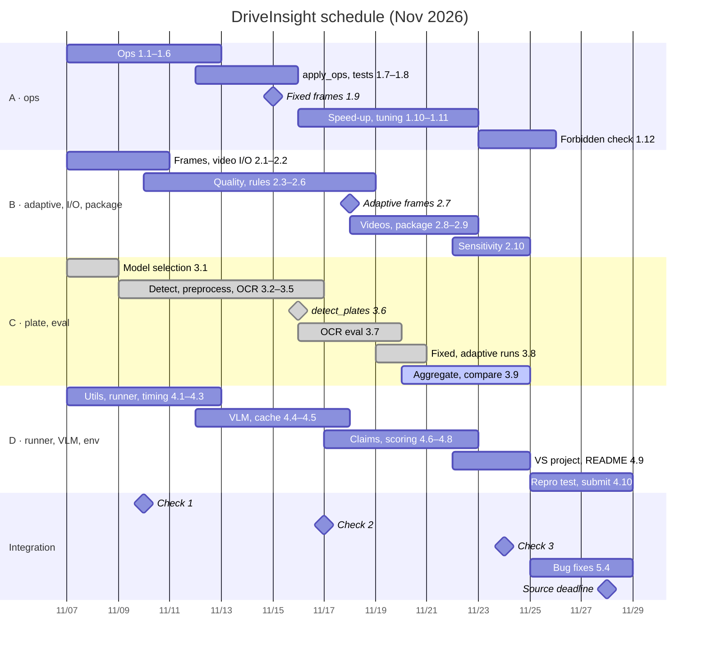

# DriveInsight Roles and WBS

Digital Image Processing Team Project 02 · Team 16 Black Box · first version Nov 6, 2026 · **updated Nov 16, 2026**

[한국어](team_plan.ko.md) · [Feature spec](feature_spec.md) · [Member C guide](member_c_guide.md)

Status columns reflect what is in the repository on Nov 16. **—** means nothing in the repo yet (work may exist outside it).

## Development roles

The code is split into four modules. One person owns one module end to end. Inputs, outputs and checks per feature are in the [feature spec](feature_spec.md).

| Member | Module | Features | Hands over |
| --- | --- | --- | --- |
| **A · Image processing ops** | `src/dip/` | Color space conversion, histogram equalization, gamma, Gaussian and median filters, unsharp masking (all NumPy), `apply_ops`, `fixed_enhance`, batch fixed frames, unit tests, speed-up for full videos, forbidden-function check script | `apply_ops` → B, fixed frames → C, D |
| **B · Adaptive enhancement + video I/O + package** | `src/io/`, `src/adaptive/`, `src/package/` | Video I/O (`extract_frames`, `read_video`, `write_video`), quality measures, rule-based parameter choice, `adaptive_enhance`, batch adaptive frames, enhanced videos, review package, threshold sensitivity script | Original frames and video I/O → all, adaptive frames → C, D |
| **C · Plate recognition + evaluation** | `src/plate/`, `src/eval/` | Vehicle and plate candidate detection, own crop preprocessing, OCR, readable/uncertain/unreadable judge, `detect_plates`, OCR evaluation, aggregation of OCR, VLM and timing, comparison between conditions | `detect_plates` → D, OCR results → B (package), comparison → all |
| **D · Experiment runner + VLM + environment** | `src/common/`, `src/pipeline/`, `src/vlm/` | Common utils, `main.py`, `run_experiment` (same frame list check, config snapshot), timing, VLM call, prompt and schema, response cache, claim extraction, VLM scoring, VS project and README, reproduction test and submission | Runner → all, VLM summary → B (package), scores and `timing.csv` → C |

All members work together only on the three integration checks and the last week's bug fixes. The final presenter is picked at random, so each member explains their module for 5 minutes once a week.

### Data work

Data work is split by clip. Each member collects clips for one condition, labels their own clips, and fact-checks someone else's clips, so judgments do not lean one way. 2–3 clips and 8–12 evaluation frames per person.

| Member | Clips (11/7–11/8) | Labels (11/9–11/14) | Label review (11/15–11/16) | VLM fact check (11/20–11/22) |
| --- | --- | --- | --- | --- |
| A | Low light, night | A's clips | B's labels | B's clips |
| B | Rain | B's clips | A's labels | C's clips |
| C | Fog, snow | C's clips | D's labels | D's clips |
| D | Backlight, tunnel, mixed | D's clips | C's labels | A's clips |

- **Clips:** 10–30 s each, public datasets or own footage only. Upload source, license and 3–5 timestamps by the morning of 11/8. B merges them into `eval_set.csv` and extracts the original frames. At least half of the frames should show a plate.
- **Labels:** follow the label schema and 3 examples from B. Only facts visible by eye. Write a plate as text only when it is clearly readable, otherwise mark it unreadable.
- **Label review:** disagreements are settled at Integration Check 2 (11/17).
- **VLM fact check:** use the sheet D makes on 11/18. Condition names are hidden. Each claim is correct, unsupported or uncheckable.

> **Status 11/16:** no label schema, `eval_set.csv` or frames are in the repo yet. C proposed a minimal plate label format in [docs/ocr_evaluation.md](../ocr_evaluation.md) (#16).

## Common rules

The interfaces and folders below do not change during development. Conditions are called orig, fixed and adaptive (same as Branch A/B/C in the proposal), so they are not confused with members A–D. If these hold, the four modules can be built separately and still connect at the integration checks.

**1. Function interfaces.** A frame is always `np.ndarray`, `dtype=uint8`, `shape=(H, W, 3)`, BGR. `params` is a JSON-serializable dict.

```python
# Member A · src/dip/
fixed_enhance(frame) -> (out, params)
apply_ops(frame, params) -> out          # called by B
# Member B · src/io/, src/adaptive/, src/package/
extract_frames(clip, timestamps) -> [png_path]
read_video(path) -> iterator[frame];  write_video(frames, fps, path)
measure_quality(frame) -> {"brightness", "contrast", "noise", "sharpness"}
select_params(quality) -> params         # e.g. {"gamma": 0.6, "denoise": "median", "ksize": 5, "unsharp": 1.2, "rules": [...]}
adaptive_enhance(frame) -> (out, params, quality)
build_package(clip_id) -> package/<clip>/
# Member C · src/plate/, src/eval/
detect_plates(frame, cond=None, frame_id=None) -> [{"bbox": (x, y, w, h), "crop_path": str, "text": str | None,
                                                    "conf": float, "status": "readable" | "uncertain" | "unreadable"}]
eval_ocr(results, labels) -> dict        # called by B's sensitivity script
aggregate(results_dir) -> results/summary.csv
compare(results_dir, labels) -> (table, cases)  # compare.csv, worse_cases.csv
# Member D · src/common/, src/pipeline/, src/vlm/
run_experiment(condition="orig" | "fixed" | "adaptive", steps) -> results/
summarize_scene(frames) -> dict          # fixed JSON schema, no OCR results in the prompt
score_vlm(verify_sheet, labels) -> summary
```

> **Proposed change (confirm 11/17):** `detect_plates(frame)` alone cannot build `crop_path`, so `cond` and `frame_id` were added as optional arguments. `detect_plates(frame)` still works; crops then go to `results/ocr/crops/misc/`.

> **Proposed change (confirm 11/17):** `compare(summary)` became `compare(results_dir, labels)`: frame counts need the OCR CSVs and labels, not only `summary.csv`. Metric changes still come from `summary.csv`.

**2. Folders.** All modules read and write PNGs under `data/frames/` instead of videos. File names are the same `<clip>_<ms>.png` in all three condition folders; this is how we guarantee the same frames in every condition.

```text
data/clips/                        original videos (do not modify)
data/eval_set.csv                  clip, timestamp_ms, condition (low_light/rain/fog)
data/frames/orig/ fixed/ adaptive/ original / fixed / adaptive frames
data/labels/                       ground-truth labels
src/common/ io/ dip/ adaptive/ plate/ vlm/ pipeline/ eval/ package/
results/ocr/ vlm/ params/ timing.csv summary.csv
package/<clip>/                    review package
```

Added since the first version:

```text
results/ocr/<cond>.csv             plate results per condition (C-08)
results/ocr/ocr_summary.csv        OCR metrics per condition (C-09)
results/compare.csv                better and worse frames per pair (C-11)
results/worse_cases.csv            plates that got worse, with both crops (C-11)
results/ocr/crops/<cond>/          plate crops, ignored by git (real plates)
weights/                           model weights, ignored by git, downloaded on first run
docs/ tools/ tests/                notes, helper scripts, pytest tests
requirements-<module>.txt          per-module dependencies until D merges requirements.txt
```

**3. Library rules.** OpenCV is only for video and image I/O. Processing functions such as `cv2.equalizeHist`, `cv2.GaussianBlur`, `cv2.medianBlur`, `cv2.filter2D` and `cv2.threshold` must not remain in submitted code. A temporary stand-in during development is allowed if its name ends in `_stub`; on 11/25 we check with `grep -r "_stub\|cv2\." src/` that all are gone (I/O calls such as `imread`, `imwrite`, `imdecode`, `imencode`, `VideoCapture` stay). Pretrained detectors, OCR and VLM are allowed as tools, so the README must have a table of where they are used and what we built ourselves.

**4. Handoffs.** Until the real output arrives, the receiver develops with the stand-in below, then swaps only the path or function.

| What | From → to | Due | Stand-in until then | Status 11/16 |
| --- | --- | --- | --- | --- |
| Original frames, `extract_frames` | B → all | 11/8 | A few PNGs cut by hand | Code in review (#6), frames — |
| `apply_ops` | A → B | 11/13 | `apply_ops_stub` (OpenCV for now) | — |
| Fixed frames | A → C, D | 11/15 | Original frames | — |
| `detect_plates`, OCR results | C → D, B | 11/16 | Fake result JSON | `detect_plates` merged (#14); OCR CSVs on 48 own dashcam frames (#78), handed over by hand since they spell plates |
| VLM response cache | D → B | 11/17 | Fake result JSON | — |
| Adaptive frames | B → C, D | 11/18 | Fixed frames | — |
| VLM scores, `timing.csv` | D → C | 11/21 | Fake result CSV | — (C built with fake CSVs; `score.csv` format proposed in [docs/aggregation.md](../aggregation.md)) |

## WBS

Development only, starting 11/7. Original frames are shared on 11/8, fixed frames on 11/15, adaptive frames on 11/18; until then, use the stand-ins above. All dates are November 2026.

| WBS | Task | Owner | Dates | Output | Depends on | Status 11/16 |
| --- | --- | --- | --- | --- | --- | --- |
| **1** | **Image processing ops** | **A** | **11/7–11/25** |  |  |  |
| 1.1 | Color space conversion (BGR↔YCrCb) | A | 11/7 | `color.py` | – | — |
| 1.2 | Histogram equalization | A | 11/7–11/8 | `ops.hist_eq` | 1.1 | — |
| 1.3 | Gamma correction (LUT) | A | 11/8 | `ops.gamma` | – | — |
| 1.4 | Gaussian filter (separable, reflect padding) | A | 11/9–11/10 | `ops.gaussian` | – | — |
| 1.5 | Median filter | A | 11/10–11/11 | `ops.median` | – | — |
| 1.6 | Unsharp masking | A | 11/11–11/12 | `ops.unsharp` | 1.4 | — |
| 1.7 | `apply_ops`, `fixed_enhance`, parameter log | A | 11/12–11/13 | `fixed.py` | 1.2–1.6 | — |
| 1.8 | Unit tests (compare with cv2 in tests only) | A | 11/13–11/15 | `tests/test_ops.py` | 1.7 | — |
| 1.9 | Batch fixed frames, share | A | 11/15 | `frames/fixed/`, `params/fixed.json` | 1.7, 2.1 | — |
| 1.10 | Speed-up for full videos (vectorize, 1080p targets) | A | 11/16–11/19 | Timing table | 1.8 | — |
| 1.11 | Over-enhancement check, tune `FIXED_PARAMS` | A | 11/19–11/22 | Tuning log | 1.9 | — |
| 1.12 | Forbidden-function check script, run on all source | A | 11/23–11/25 | `tools/check_forbidden.py`, 0 hits | 2.6 | — |
| **2** | **Adaptive enhancement + video I/O + package** | **B** | **11/7–11/24** |  |  |  |
| 2.1 | `extract_frames`, original frames, share | B | 11/7–11/8 | `io/frames.py`, `frames/orig/` | – | In review (#6) |
| 2.2 | `read_video`, `write_video`, `get_meta` | B | 11/9–11/10 | `io/video.py` | 2.1 | In review (#6) |
| 2.3 | Quality measures (brightness, contrast, noise, sharpness) | B | 11/10–11/12 | `measure_quality` | 2.1 | — |
| 2.4 | Rule design and `select_params` | B | 11/12–11/14 | `rules.py`, rule table | 2.3 | — |
| 2.5 | `adaptive_enhance` (with `apply_ops_stub`), log | B | 11/14–11/16 | `adaptive.py` | 2.4 | — |
| 2.6 | Switch to A's `apply_ops`, verify | B | 11/17–11/18 | Stub removed | 2.5, 1.7 | — |
| 2.7 | Batch adaptive frames, share | B | 11/18 | `frames/adaptive/`, `params/adaptive.json` | 2.6 | — |
| 2.8 | Enhanced videos (`enhance_video`) | B | 11/18–11/19 | `enhanced_*.mp4` | 2.2, 2.6 | — |
| 2.9 | Review package (structure with fake results first) | B | 11/19–11/22 | `build_package`, `package/<clip>/` | 2.8, 3.6, 4.5 | — |
| 2.10 | Threshold sensitivity script (±20% rerun) | B | 11/22–11/24 | `tools/sensitivity.py`, change table | 2.7, 3.7 | — |
| **3** | **Plate recognition + evaluation** | **C** | **11/7–11/24** |  |  |  |
| 3.1 | Detector and OCR selection (10 Korean plate photos) | C | 11/7–11/8 | Selection memo | – | Done (#4, #8) |
| 3.2 | Vehicle detection (`detect_vehicles`) | C | 11/9–11/10 | `detect.py` | 3.1, 2.1 | Done (#10) |
| 3.3 | Plate candidate detection | C | 11/10–11/12 | `detect_plate_candidates` | 3.2 | Done (#10) |
| 3.4 | Own crop preprocessing (gray, resize, contrast, Otsu, deskew) | C | 11/12–11/14 | `preprocess.py` | 3.3 | Done (#12) |
| 3.5 | OCR and status rules | C | 11/14–11/16 | `recognize`, `judge` | 3.4 | Done (#12) |
| 3.6 | `detect_plates`, original frame results | C | 11/16 | `results/ocr/orig.csv` | 3.5 | Done (#14, #78): 48 own dashcam frames |
| 3.7 | OCR evaluation (detection, exact match, char accuracy) | C | 11/17–11/19 | `eval/ocr.py` | 3.6 | Done (#16) |
| 3.8 | Run on fixed and adaptive frames | C | 11/19–11/20 | `fixed.csv`, `adaptive.csv` | 3.7, 1.9, 2.7 | Done (#78, #79): the same 48 frames, plus the clear reference |
| 3.9 | Aggregation (OCR, VLM, time), comparison, better/worse counts | C | 11/20–11/24 | `eval/aggregate.py`, `summary.csv` | 3.8, 4.8 | Code done (#24, #26); run on own frames (#78, #81), vehicle rate and comparison (#83, #86), AI Hub vehicle labels (#90), results per environment condition (#92); final run after D's VLM scores |
| **4** | **Experiment runner + VLM + environment** | **D** | **11/7–11/28** |  |  |  |
| 4.1 | Common utils (frame load/save, logger, timer), `main.py` skeleton | D | 11/7–11/8 | `src/common/`, `main.py` | – | — |
| 4.2 | `run_experiment` (frame list check, config snapshot) | D | 11/8–11/11 | `pipeline/run.py` | 4.1 | — |
| 4.3 | Timing per step | D | 11/11–11/12 | `timing.csv` | 4.2 | — |
| 4.4 | VLM call, prompt, fixed JSON schema | D | 11/12–11/15 | `summarize_scene`, `prompt.txt`, `schema.json` | 4.2 | — |
| 4.5 | Response cache, keyless mode, VLM on original frames | D | 11/15–11/17 | `results/vlm/orig/` | 4.4 | — |
| 4.6 | Claim extraction (verification sheet) | D | 11/17–11/18 | `extract_claims`, `verify_sheet.csv` | 4.5 | — |
| 4.7 | VLM on fixed and adaptive frames | D | 11/18–11/19 | `results/vlm/fixed/`, `adaptive/` | 4.5, 1.9, 2.7 | — |
| 4.8 | VLM scoring (scene accuracy, hallucination rate), final after 6.5 | D | 11/19–11/22 | `score_vlm`, `results/vlm/score.csv` | 4.6 | — |
| 4.9 | VS `.sln`/`.pyproj`, `requirements.txt`, README | D | 11/22–11/24 | VS project | 4.2 | — |
| 4.10 | Fresh-environment test, source zip | D | 11/25–11/28 | `Team16_BlackBox_Src.zip` | 5.4 | — |
| **5** | **Integration** | **All** | **11/10–11/28** |  |  |  |
| 5.1 | Integration Check 1: run end to end on original frames (stand-ins allowed) | All | 11/10 | Check log | 2.1, 4.2 | — |
| 5.2 | Integration Check 2: orig and fixed flow, fix interface mismatches | All | 11/17 | Check log | 1.9, 3.6, 4.5 | Agenda below |
| 5.3 | Integration Check 3: aggregate three conditions | All | 11/24 | Results fixed | 3.9 | — |
| 5.4 | Bug fixes, cleanup | All | 11/25–11/28 | Ready to submit | 5.3 | — |

Data work: all four members do the same amount on the same dates, following the data work table above.

| WBS | Task | Owner | Dates | Output | Depends on | Status 11/16 |
| --- | --- | --- | --- | --- | --- | --- |
| **6** | **Data work** | **All (own share)** | **11/7–11/22** |  |  |  |
| 6.1 | Clips per condition, sources and timestamps | All | 11/7–11/8 | `data/clips/`, timestamp list | – | — |
| 6.2 | Merge `eval_set.csv`, label schema and 3 examples | B | 11/8 | `eval_set.csv`, label guide | 6.1 | — |
| 6.3 | Label own clips | All | 11/9–11/14 | `data/labels/` | 6.2, 2.1 | — |
| 6.4 | Label cross review (A↔B, C↔D) | All | 11/15–11/16 | Labels fixed | 6.3 | — |
| 6.5 | VLM fact check of others' clips (A→B→C→D→A) | All | 11/20–11/22 | Filled `verify_sheet.csv` | 4.6, 4.7 | — |

## Schedule



Diamonds are one-day milestones, bars are task periods. The source deadline is 11/28. All four rows run until 11/24–11/25, so no one finishes early or starts late.

## Milestones and integration checks

The integration checks are on 11/10, 11/17 and 11/24. Each one joins what exists that day and runs it end to end once.

| Check | Date | What to check | Pass condition |
| --- | --- | --- | --- |
| Integration Check 1 | 11/10 (Tue) | Original frames; the runner reads them and flows through detection to summary (fake ops allowed) | One command runs to the end without errors |
| Integration Check 2 | 11/17 (Tue) | OCR and VLM on fixed frames; function I/O matches the agreement; label format matches the scoring scripts | Result CSVs for orig and fixed |
| Integration Check 3 | 11/24 (Tue) | Aggregation of three conditions, comparison table, package | Results fixed; only bug fixes after this |

### Open items for Integration Check 2 (11/17)

| # | Item | Owner | Proposal |
| --- | --- | --- | --- |
| 1 | `detect_plates` optional `cond`, `frame_id` arguments | C | Keep; old call still works |
| 2 | Label schema; plate part of it | B, C | Use the plate format in [docs/ocr_evaluation.md](../ocr_evaluation.md) or map B's schema to it |
| 3 | `eval_set.csv` condition value for snow clips (only `low_light/rain/fog` today) | B | Add `snow` or merge into `fog` |
| 4 | `data/clips/`, `data/frames/` in git? (file size, real plates) | All | Keep out of git, share by drive |
| 5 | Merge `requirements-*.txt` into `requirements.txt` | D | Pins in the risks table below; ultralytics brings `opencv-python` 5.x, PaddleOCR brings `opencv-contrib-python` 4.10 |
| 6 | `compare(results_dir, labels)` instead of `compare(summary)` | C | Keep; frame counts need the OCR CSVs and labels |
| 7 | `vlm/score.csv` columns | D, C | Counts per condition and clip as in [docs/aggregation.md](../aggregation.md); C pools them per condition |
| 8 | Result CSVs with plate text (`results/ocr/<cond>.csv`, `worse_cases.csv`) in git? | All | Keep real plate text out of git like the crops; commit `summary.csv` and `compare.csv` only |

## Risks and responses

The biggest risk is A's ops being late, so B and C wait for enhanced frames. So B develops with a stand-in first, and C and D finish their baselines on original frames by 11/16.

| Risk | Affects | Response | Decide by | Status 11/16 |
| --- | --- | --- | --- | --- |
| Ops late (especially 2D convolution speed) | A, B | Median only with small kernels (3×3, 5×5); if slow, fewer evaluation frames, but share fixed frames on 11/15 | 11/13 | — |
| Full-video enhancement too slow | A, B | If 1.10 misses the target, make enhanced videos at a lower resolution | 11/19 | — |
| Pretrained detector or OCR cannot read Korean plates | C | Check with 10 sample photos at selection. If not, manual plate boxes and automate OCR only | 11/8 | Resolved: PaddleOCR 7/10 on real photos; own plate candidate search instead of a plate detector |
| Adaptive rules worse than fixed | B | Report as is, explain with the sensitivity test (2.10) | 11/22 | — |
| VLM cost, speed, unstable output format | D | Fix prompt and schema on 11/15, no changes after. Cache every response and score without reruns | 11/15 | — |
| Package or aggregation waits for other results | B, C | Build the structure with fake result files, then swap paths. Rerun VLM final scores on the real sheet right after fact checking ends on 11/22 | 11/17 | C: eval, aggregation and comparison done with fake files (#16, #24, #26); real OCR results swapped in (#78). VLM scores and `timing.csv` still wait for D |
| cv2 processing functions or stubs left in submitted code | A, all | Run the 1.12 check script at Integration Check 3 and on 11/25 | 11/25 | `src/plate`, `src/eval`: only `imdecode`/`imencode` |
| Interface changes break integration | All | No changes. If unavoidable, announce in the group chat and apply only on an integration check day | Always | `detect_plates` optional args, see open items |
| Label schema late | All | Develop scoring with fake labels, rerun numbers when labels arrive | 11/16 | Added: no schema in the repo yet |
| Windows Application Control blocks compiled packages | All | Pin versions that load: `pandas==2.2.3`, `chardet==5.2.0` (in `requirements-plate.txt`) | 11/22 (requirements) | Added: seen on one PC |
| Antivirus HTTPS scanning breaks pip and weight downloads (`CERTIFICATE_VERIFY_FAILED`) | All | pip ≥ 24.2 uses the OS cert store; `truststore` for Python; `git -c http.sslBackend=schannel` | Always | Added: seen on one PC |
| Real plate crops or frames committed to git | All | `results/ocr/crops/` ignored; decide `data/` policy | 11/17 | Added |
